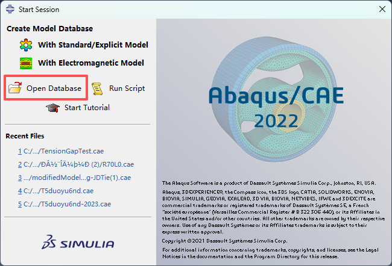
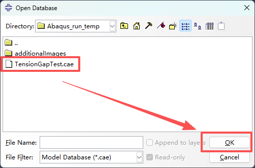
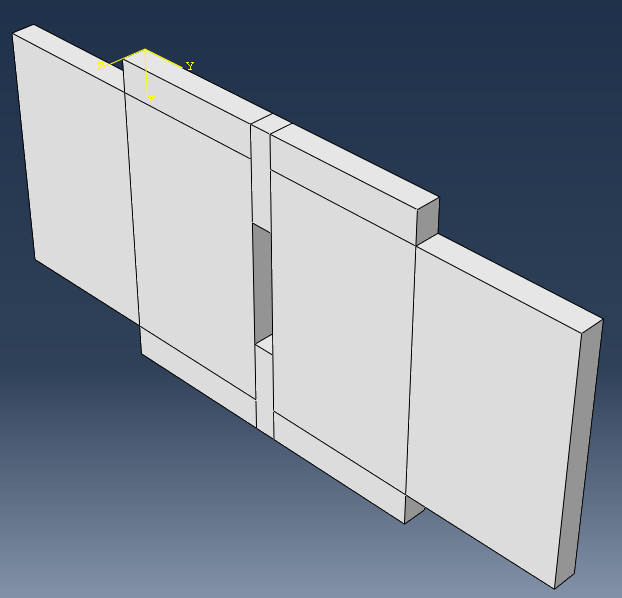
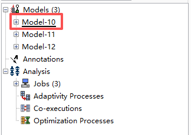
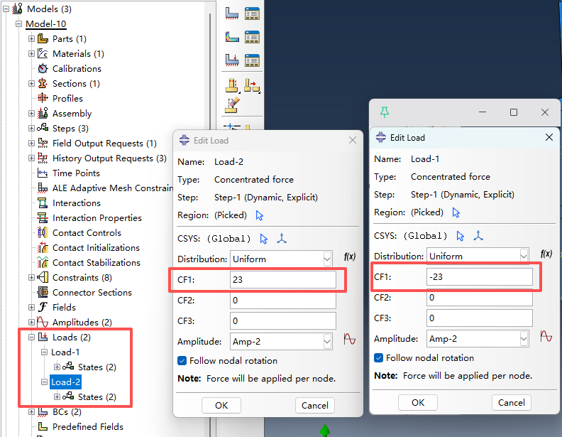
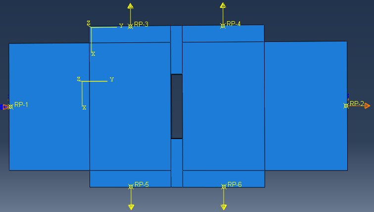
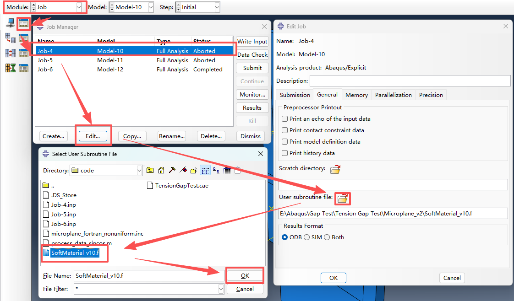
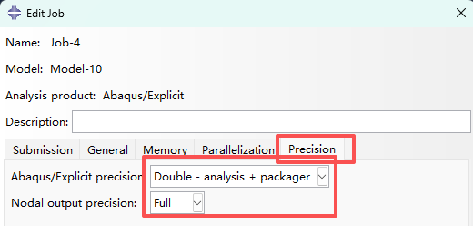

# FEM model opening, modification and running with .cae file

## File and software preparation

### File

Two file is needed here.

TensionGapTest.cae: The Abaqus/CAE model building file, records all components that the FEM is created in Abaqus/CAE.

SoftMaterial_v10.f: VUMAT file, define the material mechanical behavior, written in Fortran.

### Software

Install the Abaqus software. Moreover, due to this project use the VUMAT, a linking process is needed to link Abaqus with Visual Studio (In Windows operation system) to make the USER SUBROTINE available. There is a version matching issue for Abaqus and Visual Studio. Currently, Abaqus 2021/2022/2024 can be linked with Visual Studio 2019. There are lots of link tutorial in video sharing website like YouTube and BiliBili.

## FEM model opening

Firstly, open your Abaqus/cae software, a welcome page will display, seen in Fig.1. Then, select the target .cae file to open the FEM model. like in Fig.1.

<table>
<colgroup>
<col style="width: 50%" />
<col style="width: 49%" />
</colgroup>
<thead>
<tr class="header">
<th></th>
<th></th>
</tr>
</thead>
<tbody>
<tr class="odd">
<td><ol type="1">
<li>
welcome page of Abaqus/CAE
</li>
</ol></td>
<td><ol start="2" type="1">
<li>
Open the target .cae file
</li>
</ol></td>
</tr>
</tbody>
</table>

The FEM model will show off in the main viewport. On the upper left of the software GUI, there is a tree layout, the underline below the “Model-10” indicate that we are currently editing “Model-10”, which is correspond to “job-4.inp”.

<table>
<colgroup>
<col style="width: 50%" />
<col style="width: 50%" />
</colgroup>
<thead>
<tr class="header">
<th></th>
<th></th>
</tr>
</thead>
<tbody>
<tr class="odd">
<td><ol start="3" type="1">
<li>
FEM model
</li>
</ol></td>
<td><ol start="4" type="1">
<li>
Label of current FEM model (upper left)
</li>
</ol></td>
</tr>
</tbody>
</table>

## Boundary modification

Open the “Loads”, hen double-click on “Load-1” and “Load-2” to modify the force which is perpendicular to the loading direction. Seen in Fig.5. Specifically, “RP-3”, “RP-4”, “RP-5”, and “RP-6” are created to apply forces; “RP-1” is fixed; and “RP-2” is created to load the structure under displacement control, seen in Fig.6.

<table>
<colgroup>
<col style="width: 42%" />
<col style="width: 57%" />
</colgroup>
<thead>
<tr class="header">
<th></th>
<th></th>
</tr>
</thead>
<tbody>
<tr class="odd">
<td><ol start="5" type="1">
<li>
Load modification
</li>
</ol></td>
<td><ol start="6" type="1">
<li>
Load pattern
</li>
</ol></td>
</tr>
</tbody>
</table>

## Solve the job

Due to a user-define materials used, before run the model, the file path should be specified, seen in Fig.7. To make sure the simulation result reliable, double and full precision should also be setting. After this ,you can submit the job.

<table>
<colgroup>
<col style="width: 59%" />
<col style="width: 40%" />
</colgroup>
<thead>
<tr class="header">
<th></th>
<th></th>
</tr>
</thead>
<tbody>
<tr class="odd">
<td><ol start="7" type="1">
<li>
Subroutine file path specification
</li>
</ol></td>
<td><ol start="8" type="1">
<li>
Precision setting
</li>
</ol></td>
</tr>
</tbody>
</table>
