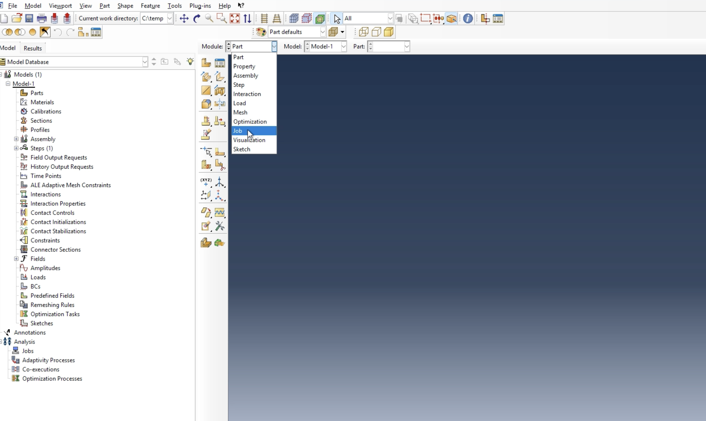
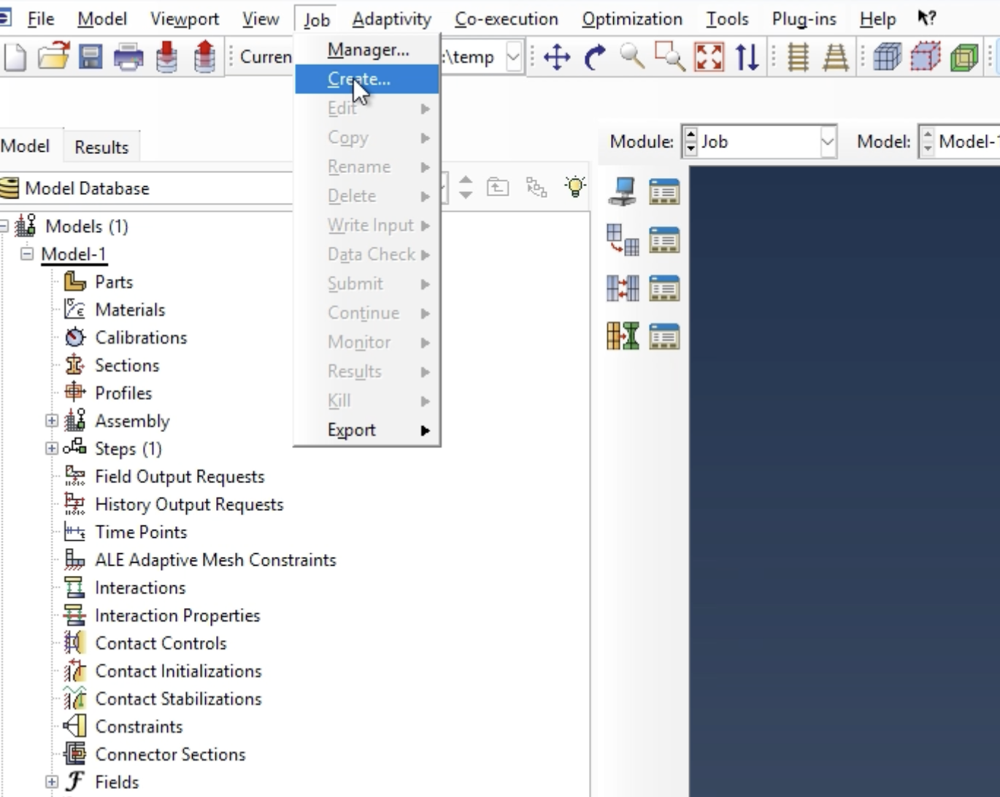
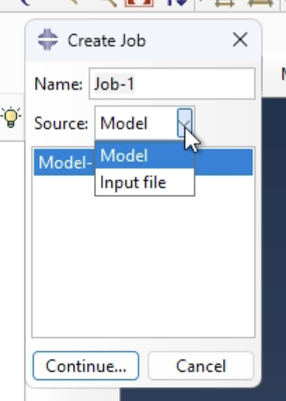
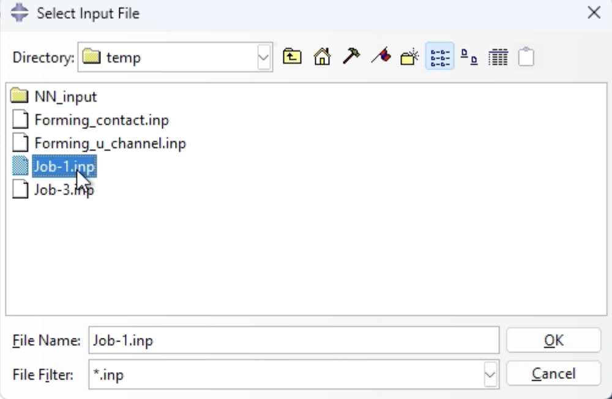
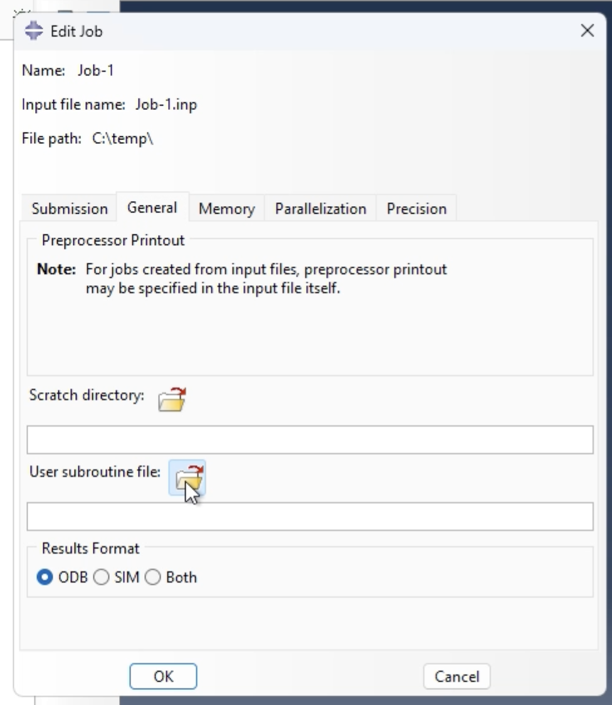
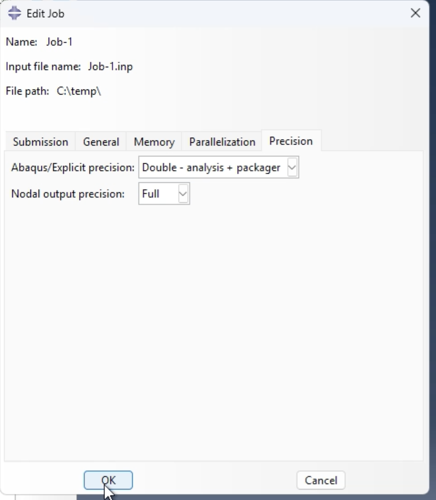
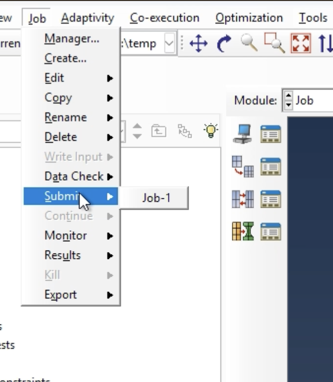
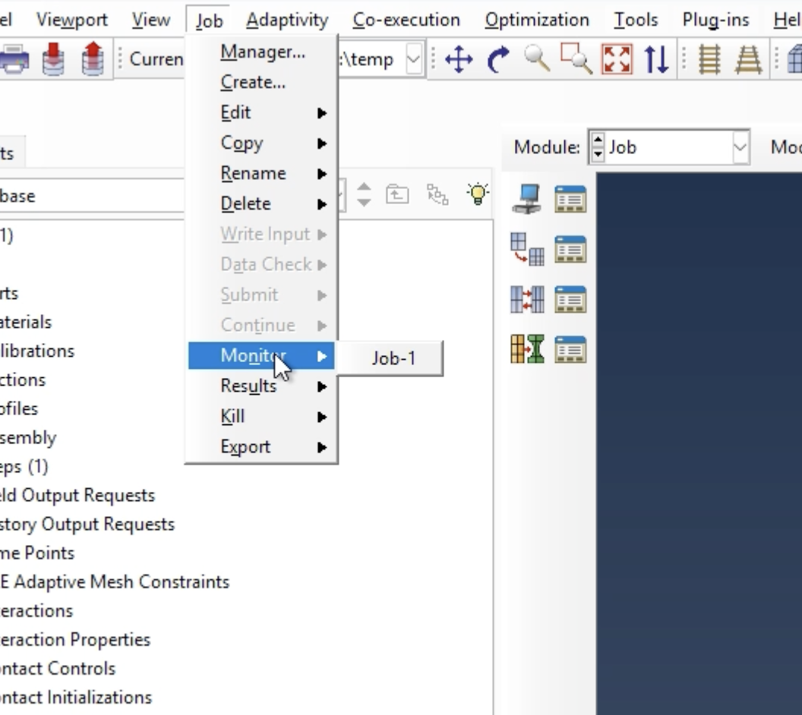

# Running a Job in Abaqus CAE

May 28, 2026

This document provides instructions for

- Uploading necessary documents for a complete job

- How to monitor the progress of a job

For instructions on how to visualize results, please see [Visualizing ODB Results Abaqus](visualizing-odb-results-abaqus.md)

Note: Not all models can be run on Bilbao. Higher computing power may be necessary in certain cases if your model will not populate.

## 1 Set Up

- Open Abaqus CAE

- Start a standard model

- As seen in figure 1, change the module to Job

Figure 1. Changing module to job

Once this has been done, select the following keys:

- Job

- Create...

Figure 2. Create new job

Now you are ready to upload your first file.

### 1.1 Model Design file

The first input file is the model’s structure and is saved as a .inp file. As seen in Figure 3, upload this .inp file by specifying the source as an input file. Then select your desired file from your documents.

Figure 3. Input job

Figure 4. Selecting input file

Now that the file is uploaded, we can change other parameters to properly run the job.

### 1.2 Source Code file

The .f file is necessary as it is the Fortran source code that will dictate the parameters underlying the model. Follow the following steps:

- General

- User subroutine file

- Locate your desired file

Figure 5. Change subroutine file

Nothing needs to be changed under the Memory or Parallelization tab. The Precision tab should be modified as seen in Figure 6.

- Abaqus/Explicit precision should be “Double - analysis + packager”

- Nodal output Precision should be “Full”

Figure 6. Modify the precision standards

You are now ready to submit the job.

## 2 Run the Job

### 2.1 Submitting the job

Follow these steps to submit the job:

- Job

- Submit

- Select your job name

Figure 7. Submit the job

### 2.2 Monitor Job

To monitor the job, follow these steps:

- Job

- Monitor

- Select your job name

- The progress of your job will propagate

Figure 8. Monitor the job

For more information on how to analyze the results, please see the document attached above.
