# Abaqus Viewer on a Mac using ODB files

May 25, 2026

This document provides instructions for

- Capturing photos of stress/strain for a computational model

- Standardizing color bars across multiple models

- Finding points of damage in a model

Note: Before following these instructions, you will need the output ODB files from running a model.

## 1 Set Up

### 1.1 Open Abaqus viewer

Select “Open Database” on the landing page of the program.

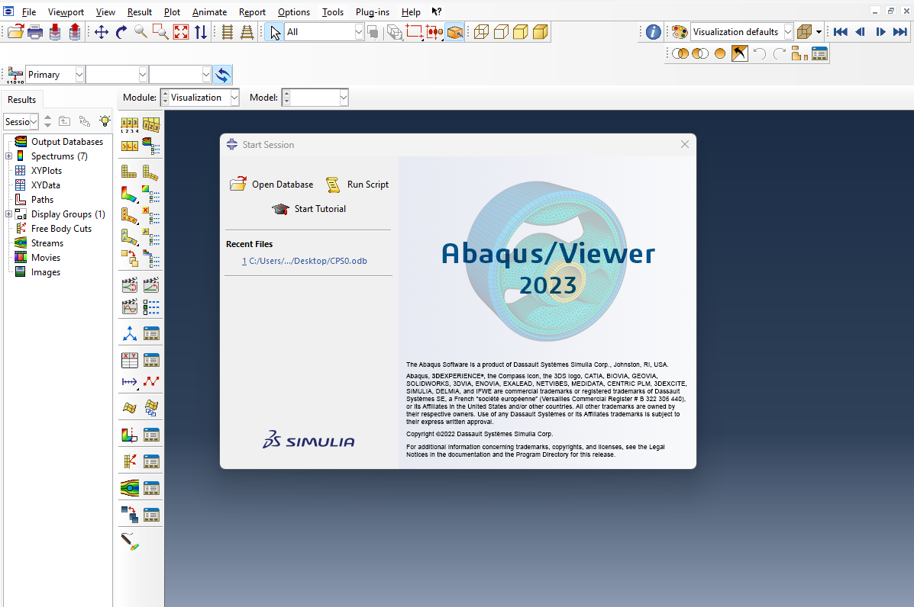

Figure 1. Abaqus/Viewer home page

Select your desired ODB file from your files and allow the model to open.

### 1.2 Position model

- To center your model, select view, then tool bars, then views

- Select the X-Y axis to center the model as desired

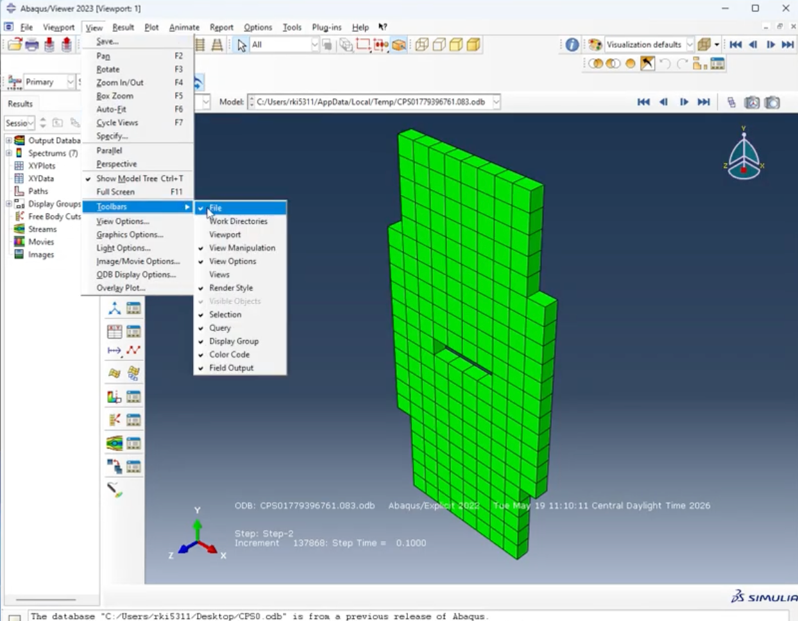

Figure 2. Arrange axes

- Turn on damage view by selecting the icon highlighted in figure 3

- The color bar will then pop up to allow you to view damage contours

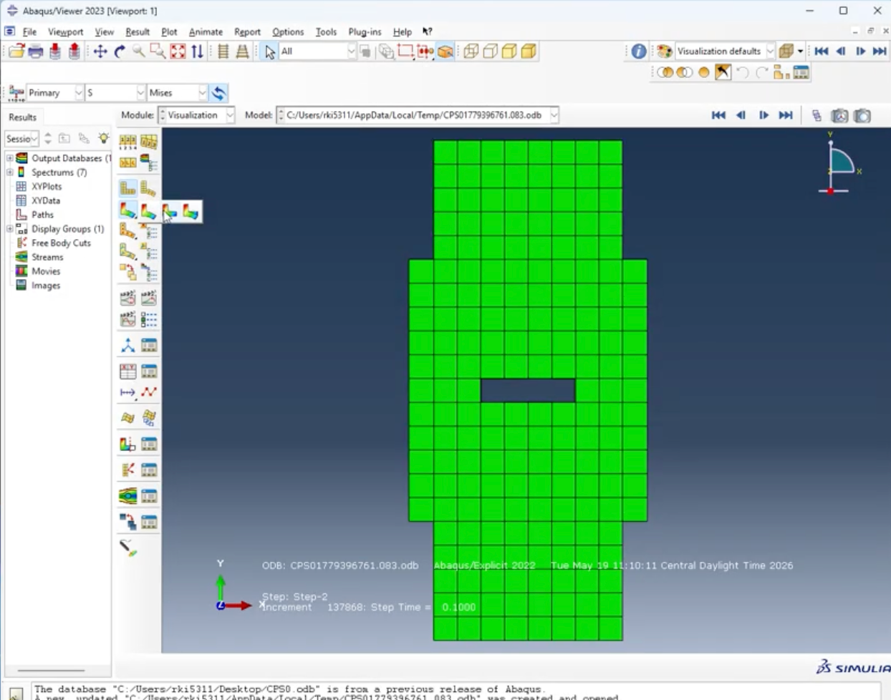

Figure 3. View damage

Next, remove extraneous parts of the model as desired.

- Select the parts you want removed with your cursor

- Select the Venn diagram icon located on the top right of the screen with the left circle shaded

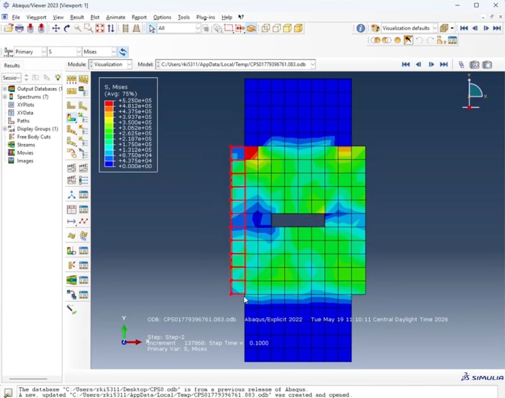

Figure 4. Cutting the model

## 2 Color Bar Standardization

Change the damage view to SDV7 to find the first instance of PDMS damage.

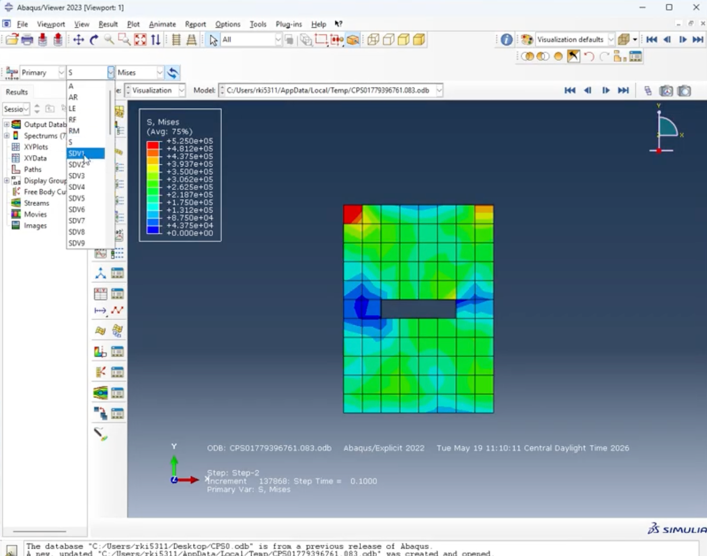

Figure 5. SDV7 analysis

Once SDV7 is on, click through the time steps to find the first instance of damage.

- The color bar should reach a maximum of 1.00

- PDMS damage should start from the center as seen in Figure 6.

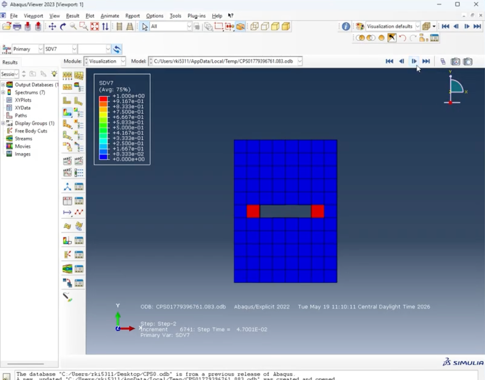

Figure 6. PDMS damage inception

Once this step of increment is found, change the view to S (rather than SDV7). Change the view next to S11. This is shown in Figure 7.

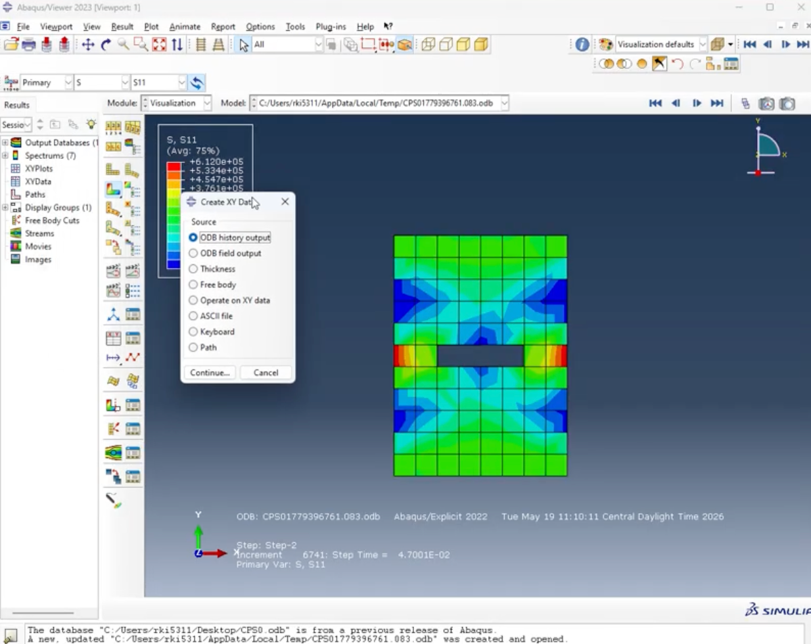

Figure 7. Primary damage view

Now, it is necessary to standardize the color bar if you are taking photos to compare multiple models. To do so:

- Click options

- Select contour

- Click limits

- Specify the limits as seen in Figure 8 to the maximum and minimum values across all the models you are comparing

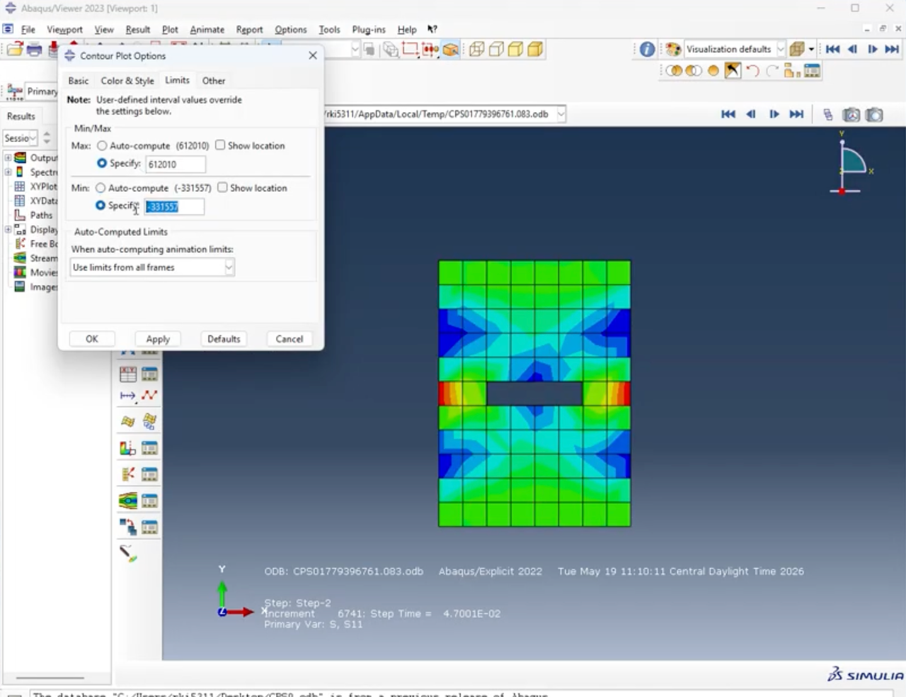

Figure 8. Limits for color bar

Once the color bars are standardized, the view is ready to be captured. Now, take a photo of the current view by clicking through the following keys:

- File

- Print

- Change file type to EPS file

- Name the file accordingly

Example file name: “CPS10_PDMS_S11.eps”

## 3 Ultimate Damage

To find the numerical values of damage, follow these keys:

- X-Y data

- ODB history output (Figure 9)

- Open RF2 (Figure 10)

- Plot data

Figure 9. ODB History Output

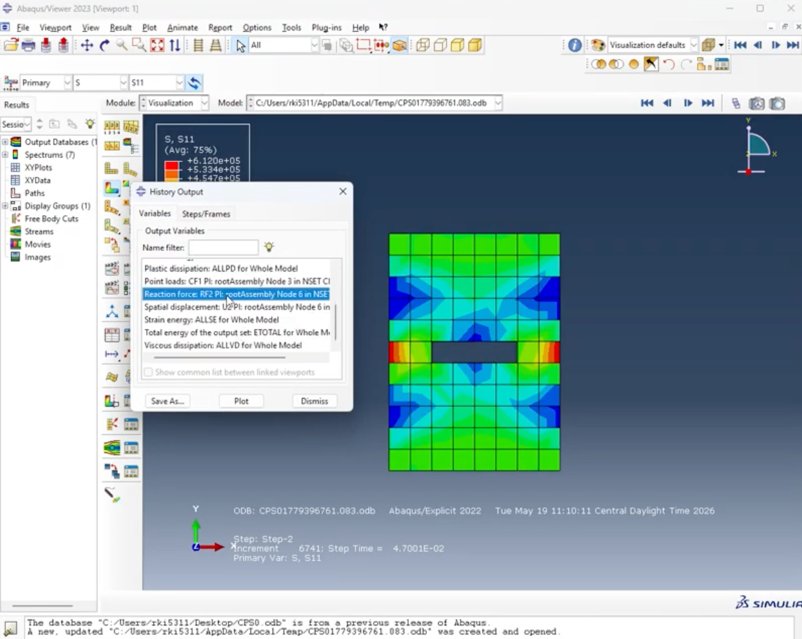

Figure 10. RF2 damage

Once the data is plotted, a graph will be generated similar to Figure 11. Now, we can use raw data to determine the maximum load, or the maximum value of force. Select the icon next to x-y data to:

- Select XY data manager

- Double click on the entry or click “Edit…”

- Edit XY data will pop up with the numerical values

- Manually search for the maximum Y value and record the X coordinate

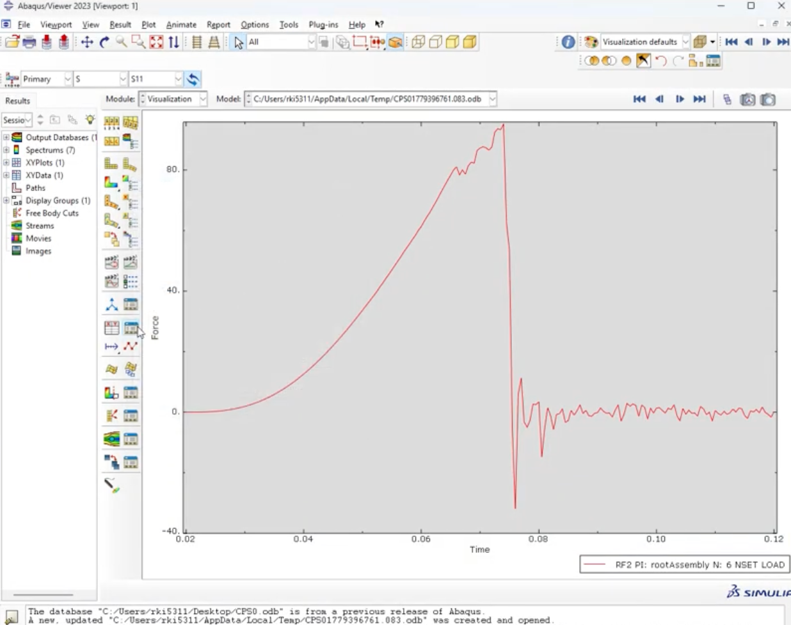

Figure 11. Plot of damage

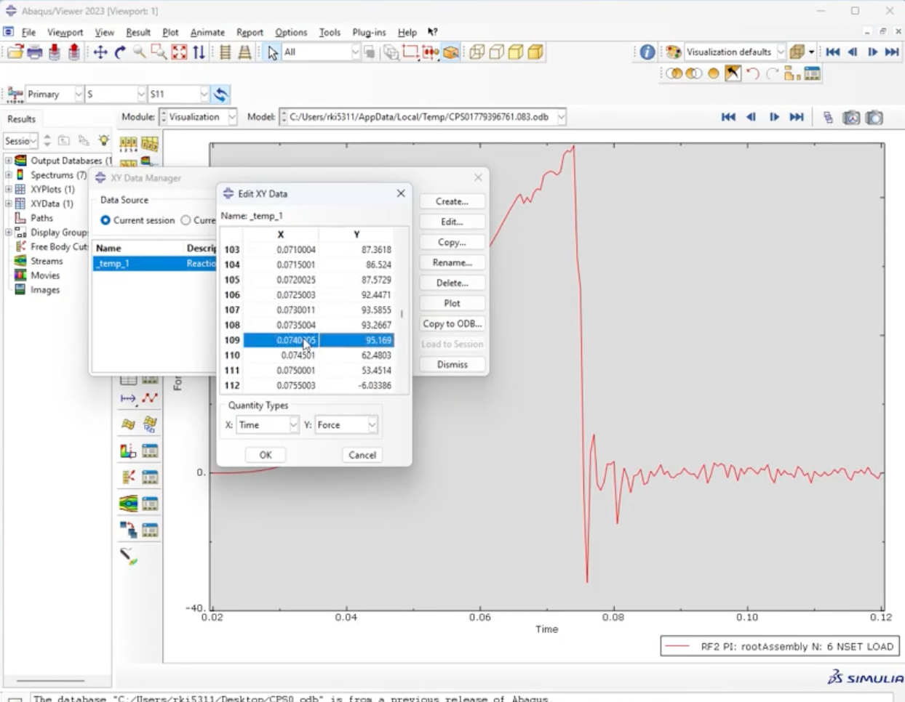

Figure 12. Edit XY data

The X coordinate corresponding with the maximum load is 0.02 more than the time step where this damage occurs. Subtract 0.02 from this value and return to the damage model to click to this time step. Repeat step 2, color bar standardization, and recapture photos for desired models.

At the end of step three, you should have two photos for a singular model. The first photo captures the point at which PDMS fails for S11 and the second photo captures the overall peak load failure for S11.

## 4 S22 Damage

Repeat steps 1 - 3 for changing S11 to S22. This will output two more photos per model according to the S22 damage.
